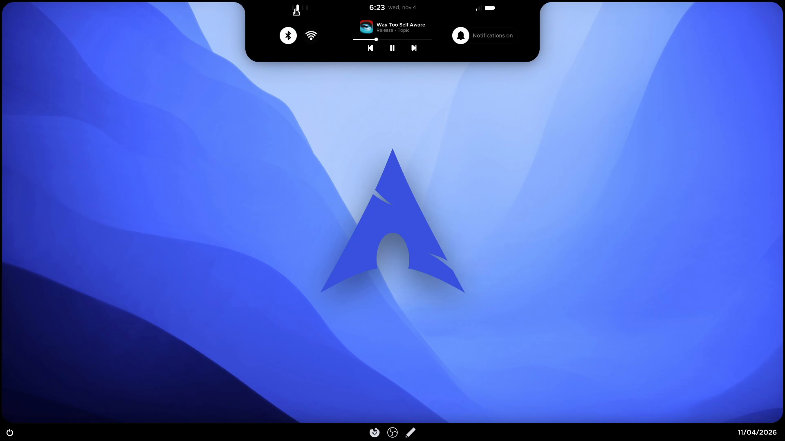

<div align="center">

# Frameshell

**A Hyprland + Quickshell desktop where everything lives in one frame.**

A dark frame around a rounded wallpaper window, a notch that grows into an island,
a dock at the bottom and panels that grow out of the edges.



</div>

## Showcase

https://github.com/user-attachments/assets/PASTE-VIDEO-LINK-HERE

## Features

- **Frame, notch and island** — hover the notch for the clock, Wi-Fi / Bluetooth, media controls and notifications
- **Panels from the edges** — volume + brightness (top-left), colour picker (top-right), clipboard history (left), quick note (right), calendar (bottom-right)
- **Own launcher, app switcher and emoji picker** — no rofi/wofi needed (`SUPER+R`, `SUPER+Space`, `SUPER+.`)
- **Wallpaper and colour-theme switchers** in the island — three themes (Default, Noir, Catppuccin Mocha) that also restyle GTK, Qt, kitty, Firefox and the window borders
- **Settings app** — blur, gaps, borders, dock / island auto-hide, pinned apps, Wi-Fi, Bluetooth, audio devices, mouse and keyboard, keybind list
- **Screenshot tool** with area selection and drawing (pencil, arrow, rectangle, text)
- **Lock screen, login screen (SDDM Pixie) and boot splash (Plymouth)** in the same style
- Notification daemon, polkit agent and on-screen keyboard built into the shell

## Tested on

Only tested on one machine so far — bug reports from other setups are very welcome.

| | |
| --- | --- |
| Distro | CachyOS |
| Hyprland | 0.57.1 (needs **0.55 or newer** — the config is Lua, `hyprland.lua`) |
| Quickshell | 0.3.2 |
| Kernel | Linux 7.3.3-cachyos |
| GPU | NVIDIA GeForce RTX 4060 |
| CPU | Intel Core i5-14400F |
| Monitor | one 1920×1080 screen, US keyboard layout |

Other Arch-based distros should work. AMD / Intel graphics and multi-monitor setups are untested.

## Install

> [!WARNING]
> The installer is made for a fresh-ish Arch / CachyOS system. It updates the system, installs
> about 60 packages, **switches your login screen to SDDM** and **your boot splash to Plymouth**
> (it asks before each of those), and sets Nautilus, Celluloid, VS Code and GNOME Text Editor as default apps.
> Every config file it replaces is moved to `~/.config/frame-backup-<date>/` first.
> Run it with `--dry-run` first to see exactly what it would do.

```bash
git clone https://github.com/Swapy-y/frameshell.git
cd Frameshell
./install.sh --dry-run    # shows every step, changes nothing
./install.sh              # asks before the big steps
```

Then reboot and pick the **Hyprland** session on the login screen.

| Flag | What it does |
| --- | --- |
| `--dry-run` | show everything, change nothing |
| `--no-packages` | only copy the config files (no pacman / AUR / drivers / login / boot changes) |
| `--no-login` · `--no-boot` | keep your login screen · keep your boot splash |
| `--no-nvidia` · `--no-icons` | skip the NVIDIA checks · don't download the YAMIS icon pack |
| `--yes` | answer yes to every question |
| `--grub` | *opt-in:* hide the GRUB menu and boot quietly (edits 3 settings in `/etc/default/grub`, keeps a backup) |
| `--english-locale` | *opt-in:* set the whole system language to English (US) |
| `--firefox-keys` | *opt-in:* the author's Firefox shortcuts (`Ctrl+X` closes a tab, `Ctrl+W` opens one …) |

**Just want to look around?** `./install.sh --no-packages` copies only the dotfiles. The shell runs with `qs -c frame`.

## Keybinds

The keys are **Hyprland's defaults**; the shell's extras sit on keys the defaults leave free.
`SUPER` is the Windows key. The Settings app's *Keybinds* page lists them all.

| Hyprland defaults | | Frameshell extras | |
| --- | --- | --- | --- |
| `SUPER+Q` | terminal | `SUPER+Space` | app switcher (hold SUPER) |
| `SUPER+C` | close window | `SUPER+Escape` | lock screen |
| `SUPER+M` | log out (asks first) | `SUPER+B` | browser |
| `SUPER+E` | file manager | `SUPER+N` | text editor |
| `SUPER+R` | app launcher | `SUPER+F` · `F11` | maximize · fullscreen |
| `SUPER+V` | toggle floating | `SUPER+H` | minimize |
| `SUPER+P` | pseudotile | `SUPER+Z` | swap window |
| `SUPER+J` | toggle split | `SUPER+Shift+arrows` | move window |
| `SUPER+arrows` | move focus | `SUPER+Ctrl+←/→` | wallpaper switcher |
| `SUPER+1…5` | workspace | `SUPER+Ctrl+↑/↓` | colour theme switcher |
| `SUPER+Shift+1…5` | move window to workspace | `SUPER+PageDown` | tiling on/off for the workspace |
| `SUPER+S` · `SUPER+Shift+S` | scratchpad · move window there | `SUPER+.` · `SUPER+\` | emoji picker · on-screen keyboard |
| `SUPER+scroll` | next / previous workspace | `SUPER+,` | calendar |
| `SUPER+drag` | move (left) / resize (right) | `Print` · `Shift+Print` | screenshot area · screen |

At the edge of the screen `SUPER+←/→` and `SUPER+Shift+←/→` continue to the workspace beside it.
Change keys in the *KEYBINDINGS* section of `~/.config/hypr/hyprland.lua`.

## Customize

| What | Where |
| --- | --- |
| Most things (blur, gaps, borders, dock, wallpapers, themes, input) | the **Settings** app (`SUPER+R` → “Settings”) |
| Shell options, colour themes, corner radius | `~/.config/quickshell/frame/Config.qml` (saves reload live) |
| Keybinds, apps behind the keys, monitors, animations | `~/.config/hypr/hyprland.lua` |
| Wallpapers | `~/.local/share/frameshell/wallpapers`, or *+ Add* in Settings |

Everything is explained in the **[manual](docs/MANUAL.md)**: every panel, every setting, NVIDIA notes and a troubleshooting table.

## Going back

- Your old configs are in `~/.config/frame-backup-<date>/`.
- The installer prints the command to switch back to your old login manager (e.g. `sudo systemctl disable sddm && sudo systemctl enable gdm`).
- Boot splash: `sudo plymouth-set-default-theme -l` lists themes; pick one with `sudo plymouth-set-default-theme <name>` and rebuild the initramfs.
- With `--grub`: `sudo cp /etc/default/grub.frameshell-backup /etc/default/grub && sudo grub-mkconfig -o /boot/grub/grub.cfg`.

## Credits

Inspired by the Hyprland rices of [saneAspect](https://www.youtube.com/@saneAspect) on YouTube.

Frameshell bundles or builds on other people's work — thank you:

- [Pixie SDDM](https://github.com/xCaptaiN09/pixie-sddm) by xCaptaiN09 (MIT) — login screen and the lock screen's look
- [arch-darwin](https://github.com/armoredvortex/plymouth-theme-arch-darwin) by ArmoredVortex (MIT) — boot splash
- [KvLibadwaita](https://github.com/GabePoel/KvLibadwaita) by GabePoel (GPL-3.0) — base of the Frame Kvantum themes
- [adw-gtk3](https://github.com/lassekongo83/adw-gtk3) — base of the Frame GTK themes (installed, not bundled)
- Clarity City by VMware (SIL OFL 1.1) — the shell's font
- YAMIS icon pack by DIRN (GPL-3.0) — downloaded by the installer, not bundled
- [Catppuccin](https://catppuccin.com) — the Mocha colour theme
- Motion curves inspired by the [Caelestia](https://github.com/caelestia-dots/shell) shell
- Built with [Hyprland](https://hypr.land) and [Quickshell](https://quickshell.org)

Each bundled component keeps its own licence file in its folder (see `SOURCE.txt` next to it for the exact commit and what was changed).
Wallpaper sources are listed in [`docs/WALLPAPER-CREDITS.md`](docs/WALLPAPER-CREDITS.md).

## License

[GPL-3.0](LICENSE). Bundled third-party components keep their own licences (above).
